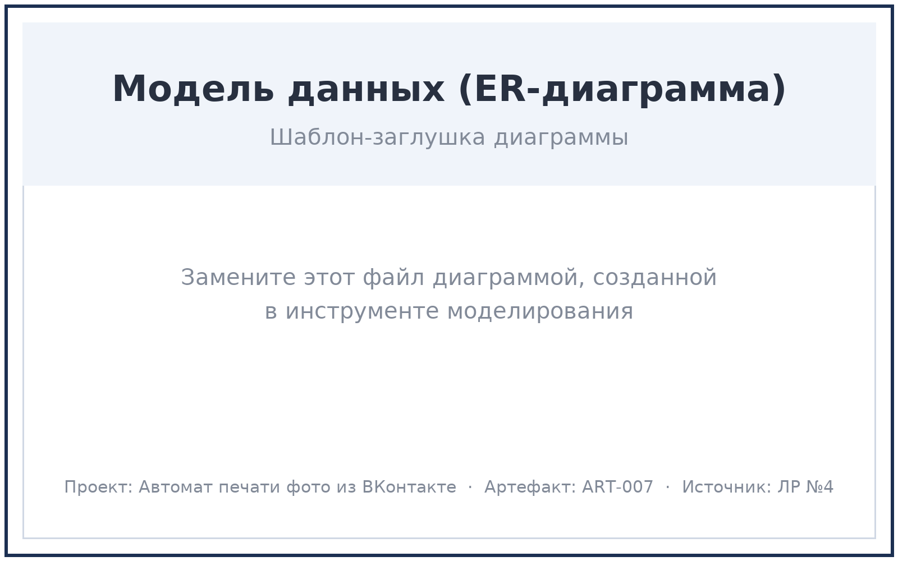

# Модель данных

## Идентификатор
ART-007

## Тип артефакта
Диаграмма

## Источник
ЛР №4

## Назначение
Описать сущности, атрибуты и связи, необходимые для работы системы.

## Диаграмма

## Сущности
| Сущность | Описание | Ключевые атрибуты |
|---|---|---|
| [Пользователь] | [Клиент, авторизующийся через ВКонтакте] | [ID, ВК-ID, имя, телефон, дата регистрации] |
| [Заказ] | [Заявка на печать выбранных фото] | [ID, ID пользователя, статус, сумма, дата создания] |
| [Фото] | [Выбранное фото из ВКонтакте внутри заказа] | [ID, ID заказа, ссылка на источник, формат печати, количество копий] |
| [Оплата] | [Платёж по заказу] | [ID, ID заказа, сумма, способ оплаты, статус, дата] |
| [Задание печати] | [Задание для принтера автомата] | [ID, ID заказа, статус печати, время постановки, время выполнения] |
| [Автомат] | [Терминал печати] | [ID, адрес размещения, статус, остаток бумаги] |

## Миграции и наполнение
- Скрипты создания схемы: `database/migrations/`
- Тестовые данные: `database/seed/`
