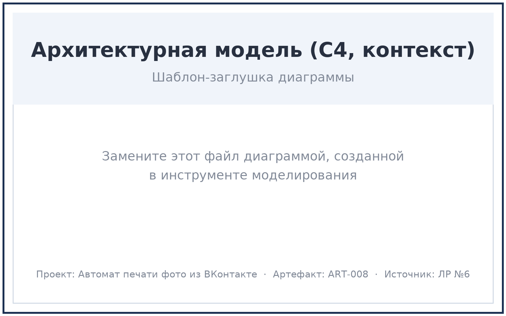

# Архитектура системы

## Идентификатор
ART-008

## Тип артефакта
Диаграмма

## Источник
ЛР №6

## Назначение
Описать компоненты системы и их взаимодействие.

## Диаграмма

## Компоненты
| Компонент | Ответственность | Взаимодействие |
|---|---|---|
| [Веб-интерфейс пользователя] | [Выбор фото, оформление и оплата заказа с телефона] | [Вызывает API системы] |
| [Серверная часть (API)] | [Обработка заказов, статусы, интеграции] | [Обращается к БД и внешним сервисам] |
| [База данных] | [Хранение пользователей, заказов, оплат и статусов] | [Используется серверной частью] |
| [Модуль управления принтером] | [Приём заданий и печать на автомате] | [Получает задания из очереди печати] |
| [Интеграция с ВКонтакте] | [Получение фото и авторизация пользователя] | [Взаимодействует с API ВКонтакте] |
| [Сервис оплаты] | [Приём платежей] | [Вызывается серверной частью] |
