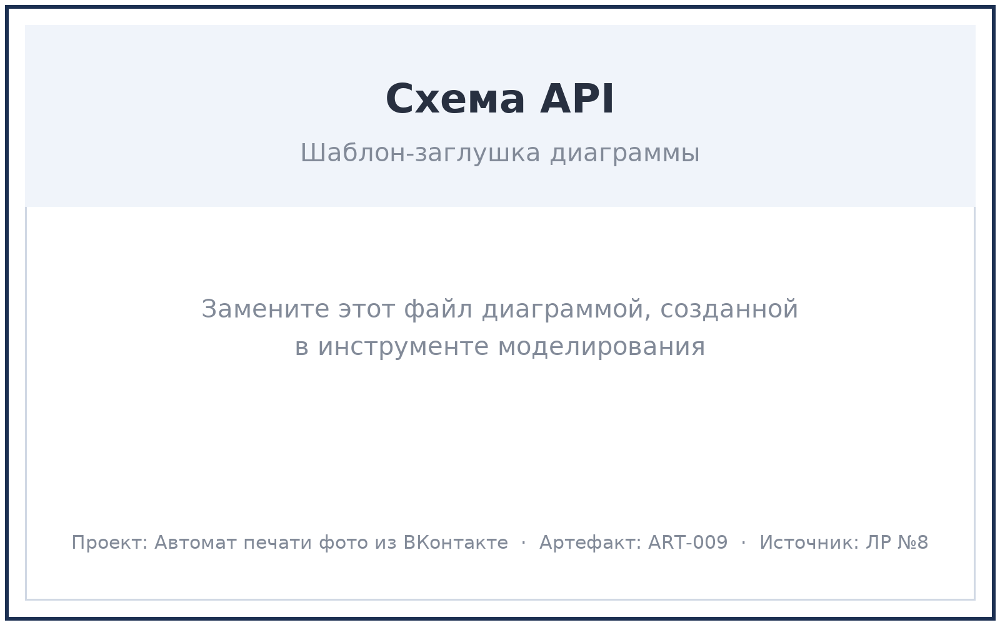

# Обзор API системы

## Идентификатор
ART-009

## Тип артефакта
Спецификация

## Источник
ЛР №8

## Назначение
Зафиксировать контракты интерфейсов между веб-интерфейсом, серверной частью и модулем печати.

## Спецификация
Полная спецификация OpenAPI находится в файле [`api/openapi.yaml`](../../api/openapi.yaml).

## Схема API

## Группы операций
- [Авторизация через ВКонтакте и управление сессией]
- [Получение альбомов и фото пользователя]
- [Создание заказа и расчёт стоимости]
- [Оплата заказа]
- [Статус задания печати]
- [Статусы автоматов и выручка (для владельца)]
